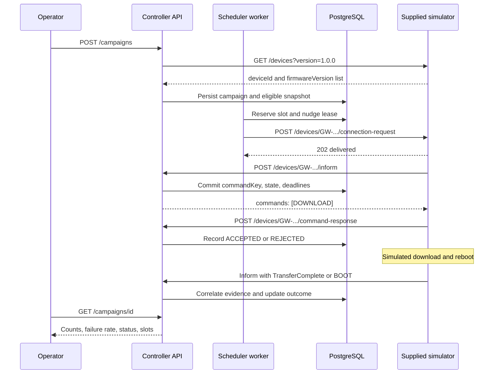

# Supplied simulator and controller integration

## Source and execution boundary

`scripts/fw_simulator.py` is an unchanged copy of the supplied `device_simulator.txt`. Its SHA-256 is:

```text
b2f0da91e8b9bb7375f46c5e2497d218df588bccdc9b80b196dc3aae95a1c4d8
```

The `.txt` file contains executable Python; only its filename/location changed. Ruff excludes this one reference file to preserve its bytes. The controller, tests, and other application code remain linted. The PDF permits simulator corrections or equivalent implementations, but the default integration does not modify the supplied behavior. An explicitly selected adapter consumes commands returned to duplicate informs, bounds HTTP callback admission, and retries transient callback failures without editing this source. Raw and adapter runs are reported separately.

The simulator is a separate FastAPI process. It uses neither controller database models nor controller transition functions. Docker Compose connects the two services over HTTP:

- Controller calls `http://simulator:8001` through `SIMULATOR_URL`.
- Simulator calls `http://api:8000` through `CONTROLLER_URL`.
- The host exposes controller port 8000 and simulator port 8001.
- The simulator healthcheck requests `/openapi.json`; no inventory polling is used for health or upgrade decisions.
- `GET /_admin/summary` is interviewer-only ground truth. The controller must never depend on it; the validation/reporting harness may compare it with outcomes after a run.

## One device's upgrade



A connection request is a nudge, not a Download RPC. Download exists only in the controller's response to an inform session. TransferComplete is a field in a later inform, not a separate endpoint. Neither HTTP 202 nor ACCEPTED proves successful firmware installation.

## Function-to-function mapping

| Supplied simulator function | Behavior | Controller counterpart |
|---|---|---|
| `lifespan()` / `pick_profile()` | Build seeded `GW-...` identities and profiles; start per-device periodic tasks and an HTTP client. | Controller treats IDs as opaque strings and snapshots the filtered inventory in `controller.api.create_campaign()`. |
| `list_devices()` | Return IDs and current versions without revealing profiles. | One bounded inventory operation during campaign creation; never success polling. |
| `connection_request()` | Return 202 for known devices. Online, non-busy devices schedule an inform after 0.2–3 seconds. | `controller.worker.send_nudge()` records status/transport metrics and schedules only safe nudge retries. |
| `periodic_loop()` | Send PERIODIC when online and not busy. | `controller.api.inform()` observes firmware; eligible admitted devices may receive a command in a session. PERIODIC alone does not establish upgrade success. |
| `inform()` | Post event/version; execute returned DOWNLOAD commands by spawning `handle_download()`. | `controller.service.process_inform()` persists command intent before returning it. |
| `handle_download()` | Reject malformed commands, busy devices, or reject profiles. Otherwise acknowledge, delay, change firmware when appropriate, then report BOOT/completion. | The durable attempt owns the unique key, ACK/result deadlines, evidence, and terminal result. |
| `respond()` | Post ACCEPTED/REJECTED with the same command key and optional reason. | `controller.api.command_response()` and `process_ack()` validate device/key ownership and prevent state regression. |
| `post()` / `duplicate_post()` | Send a callback; sometimes send the same payload again after 0.1–5 seconds. | Known keyed duplicates remain idempotent. See the unkeyed session limitation below. |
| `admin_summary()` | Reveal profile totals, actual firmware versions, and busy count. | No controller counterpart. Reserved for external validation. |

`startTime` and `completeTime` are floating-point Unix epoch seconds from `time.time()`. Existing Pydantic datetime parsing accepts this format, including fractional seconds; regression tests exercise it directly. Device clock values do not drive controller deadlines.

Operator diagnostics expose `faultCode`, `lastBootVersion`, `dispatchedAt`, `resultDeadline`, and `finishedAt` in the device listing. For the full chronology, use the read-only `GET /campaigns/{id}/events` endpoint with optional `deviceId` and `commandKey` filters. `after=0&limit=100` starts a page; the maximum limit is 500, and `nextCursor` is passed as `after` for the next page. This reads the controller's durable evidence without consulting simulator ground truth.

When a healthy late-completion path first succeeds from BOOT, the later matching TransferComplete is new corroborating evidence, not a duplicate. It increments the `late_completion` callback classification and appends a `completion_observation` event with reason `LATE_CORROBORATION`. Repeated TransferComplete messages are then classified as duplicates. The terminal outcome and its original evidence source remain stable; contradictory terminal evidence is recorded separately.

## Profiles and expected interpretation

| Profile | Default probability | Actual simulator behavior | Controller result |
|---|---:|---|---|
| `healthy` | 83% remainder | ACCEPTED, target firmware, zero-fault TransferComplete. A late path sends BOOT first. | Confirmed success or earlier BOOT-inferred success. |
| `offline` | 5% | Nudge returns 202 but no callback; no periodic informs. | Pre-dispatch TIMED_OUT after bounded nudges. |
| `reject` | 3% | REJECTED with `UNSUPPORTED_IMAGE`. | FAILED with acknowledgment evidence. |
| `fault` | 4% | ACCEPTED, old firmware, TransferComplete fault 9010. A late path may send old-version BOOT first. | FAILED on the matching fault; old BOOT waits for further evidence/deadline. |
| `no_tc` | 3% | Target firmware and BOOT, no TransferComplete. | SUCCEEDED with `boot_inferred` evidence. |
| `revert` | 2% | Old firmware and BOOT, no TransferComplete. | Wait result deadline, then FAILED/BOOT_OLD_VERSION. |

Duplicate probability (5%) applies to successful callback posts independently of the profile. Late-completion probability (5%) applies on the TransferComplete path; `no_tc` and `revert` return after BOOT instead. These probabilities are not additional fleet profile buckets.

Fleet generation has a dedicated seeded RNG. Delays, duplicates, and late choices share another RNG across asynchronous tasks. Fixed seed therefore reproduces the fleet profiles, but different callback scheduling can change timing and duplicate/late decisions. Counts from a particular run are evidence, not a universal exact-count assertion.

The simulator does not fetch `imageUrl`, validate an image signature, or install firmware on hardware. It validates that command key and target version exist, then models firmware state changes in memory. Restarting its process resets the fleet; leave it running when validating controller recovery.

## Timing and runnable profiles

| Setting | Standard Compose | Accelerated demo |
|---|---:|---:|
| `DEVICE_COUNT` | 1,000 | 1,000 |
| `SEED` | 42 | 42 |
| `OLD_VERSION` | 1.0.0 | 1.0.0 |
| `PERIODIC_INFORM_SEC` | 300 | 30 |
| `DOWNLOAD_MIN_SEC` / `DOWNLOAD_MAX_SEC` | 2 / 20 | 0 / 1 |
| `REBOOT_MIN_SEC` / `REBOOT_MAX_SEC` | 5 / 240 | 1 / 3 |
| `P_DUPLICATE` / `P_LATE` | 0.05 / 0.05 | 0.05 / 0.05 |
| `LATE_EXTRA_SEC` | 600 | 60 |
| Controller inform / ACK / result deadline | 90 / 30 / 900 seconds | 20 / 10 / 120 seconds |

The supplied simulator requires `LATE_EXTRA_SEC >= 60`, even in accelerated mode. The standard result deadline covers up to 20 + 240 + 600 = 860 seconds of simulated delay plus callback allowance. The demo allows 120 seconds for results versus up to 1 + 3 + 60 seconds of configured device delays; callback queueing can still exceed that allowance under load. Do not combine demo controller deadlines with standard simulator delays. `DEVICE_COUNT` is configurable, and the controller accepts inventory up to 10,000 devices; this does not change the campaign's independent `maxConcurrent` limit. See [scale validation](scale-validation.md) for measured conditions and outcomes.

```sh
# Supplied simulator, original timing defaults
docker compose up --build -d

# Same raw source and failure probabilities, shorter supported timing values
docker compose -f compose.yaml -f compose.demo.yaml up --build -d

# Local demo with duplicate-response handling and bounded, retried callbacks
docker compose -f compose.yaml -f compose.demo.yaml -f compose.simulator-fix.yaml up --build -d
```

Use the README campaign request, or `uv run python scripts/run_campaign.py`, after services are healthy. To observe an existing campaign and allow already-dispatched work to drain after a halt:

```sh
uv run python scripts/run_campaign.py --campaign-id CAMPAIGN_ID --halt-drain-seconds 120 --output reports/observed-campaign.json
```

The runner does not create a new campaign when `--campaign-id` is supplied and does not resume a halted one. It saves the initial halt snapshot and final observation, including its age and stop reason. Optional `--simulator-summary-url http://127.0.0.1:8001/_admin/summary` captures interviewer diagnostics only after monitoring; it never drives the controller's state machine or success decision. When using `--restart-after`, supply `--compose-project` and repeat `--compose-file` for the actual stack, especially if monitoring a controller on a nondefault port. For a clean independent test, intentionally reset the project with `docker compose down -v` before startup; that command deletes local campaign history. To preserve history, use a separate Compose project and nonconflicting host ports instead.

## Reliability limits of the raw supplied simulator

1. **No Download deduplication.** There is no persistent set of completed command keys. A second Download may be rejected while busy or executed again after busy clears. The controller never assumes that key reuse makes installation safe; it does not automatically retransmit Download.
2. **Callback errors are not retried.** `post()` logs HTTP/transport errors and returns `None`. A controller restart can coincide with a lost acknowledgment, BOOT, or TransferComplete. Persisted controller state survives, but missing device evidence cannot be invented. Missing ACK alone waits; a dispatched command with no outcome evidence becomes OUTCOME_UNKNOWN, retains its slot, and halts new dispatch.
3. **Duplicate inform responses are ignored.** `duplicate_post()` sends the callback but discards the response body. If an unkeyed periodic/BOOT inform originally arrived before admission and its duplicate arrives after admission, the controller cannot distinguish it from a new session and might return the first Download to a caller that discards it. There is no session/event ID in the assignment schema. Guaranteeing delivery or exactly-once session handling requires a protocol extension; unsafe redispatch is not a valid workaround.
4. **BOOT is uncorrelated evidence.** BOOT carries no command key/event timestamp. Target-version BOOT supports inferred success for the sole active attempt; old-version BOOT alone waits for a deadline. Stale BOOT ambiguity is documented rather than hidden.
5. **Busy can outlive inferred success.** On a late path, the simulator remains busy until it sends delayed TransferComplete, even after BOOT reports target firmware. Controller concurrency counts tracked upgrade attempts, not an unknowable device-side busy flag. It never polls the admin endpoint to manufacture stronger guarantees.
6. **Callbacks share an unbounded admission path.** Periodic informs, ACKs, BOOTs, and completions all enter one HTTPX client, configured for up to 500 connections with the default 20 idle connections. The simulator does not limit callback admission before this pool. A growing request queue adds client-side work and can delay upgrade callbacks; `handle_download()` waits for the ACK request before starting its simulated download/reboot delays. The [scale investigation](scale-validation.md) separates this delay from controller request processing.

Pause stops new command authorization; already authorized replies and existing device operations can continue. Resume after a failure-threshold halt is explicit and starts a new gate sample. Unknown outcomes must be reconciled by later evidence before resuming. These policies preserve correctness when the supplied transport behavior makes a complete, successful fleet run impossible under a particular interruption.

## Optional callback corrections

A raw mixed-fleet validation reproduced a command-delivery hole in `duplicate_post()`. The sequence is:

1. An original unkeyed inform arrives while its device is still PENDING and receives an empty command list.
2. The scheduler admits the device before the delayed duplicate arrives.
3. The duplicate is indistinguishable from a usable new session under the supplied schema. The controller durably authorizes its first Download and includes it in the response.
4. Raw `duplicate_post()` discards that response, so no download starts and no acknowledgment or completion is sent. The controller truthfully reaches OUTCOME_UNKNOWN and retains the slot.

`simulator/supplied_adapter.py` temporarily replaces `post()` and `duplicate_post()` during its lifespan and restores them at shutdown, including startup failures. Returned DOWNLOAD commands from duplicate informs go to the original `handle_download()`, matching the original `inform()` behavior. The adapter reuses the supplied inventory, nudge endpoints, device tasks, profile/timing RNG, configured delays, probabilities, and download handler. A separate RNG supplies retry jitter. The source checksum remains unchanged.

`simulator/callback_transport.py` admits requests through semaphores **before** calling HTTPX. Periodic informs have their own client and budget; ACK, BOOT, TransferComplete, connection-request informs, and other callbacks use a separate critical client. Each pool's connection and idle-connection limits match its budget, with a four-second keepalive expiry. Periodic requests therefore cannot occupy the critical pool's connections. This limits concurrent HTTP work, not the number of waiting device tasks: admission wait has no absolute expiry and is measured separately from network time.

All callback kinds retain the same payload, command key, and device timestamps across delivery attempts. Transport failures, whole-attempt timeouts, HTTP 429, and HTTP 5xx are retried; other HTTP errors and malformed success responses are not. Each network attempt has both HTTPX phase timeouts and a whole-attempt timeout. Backoff is exponential with jitter. A valid numeric or HTTP-date `Retry-After` is honored when its delay fits the configured maximum; a longer requested delay stops delivery attempts rather than retrying earlier than the server permits. HTTP permits are released during backoff. After the final unsuccessful attempt or an excessive requested delay, the callback is logged and counted as exhausted.

Select the adapter with `-f compose.simulator-fix.yaml` after the base and optional demo files. That override forwards these variables from the shell or `.env`:

| Variable | Default | Meaning |
|---|---:|---|
| `SIM_CALLBACK_PERIODIC_CONCURRENCY` | 16 | Maximum admitted periodic HTTP attempts; 1–128. |
| `SIM_CALLBACK_CRITICAL_CONCURRENCY` | 32 | Maximum admitted critical HTTP attempts; 1–128. |
| `SIM_CALLBACK_MAX_ATTEMPTS` | 3 | Total attempts per callback, including the first; 1–10. |
| `SIM_CALLBACK_REQUEST_TIMEOUT` | 5 | Seconds per network attempt; greater than 0, at most 60. Excludes admission wait and backoff. |
| `SIM_CALLBACK_RETRY_BASE_DELAY` | 0.2 | Initial exponential-backoff basis in seconds; greater than 0, at most 10. |
| `SIM_CALLBACK_MAX_RETRY_DELAY` | 2 | Maximum backoff delay in seconds; greater than 0, at most 30. |

At the defaults, each callback receives at most **three attempts, not three retries**. Total delivery time can exceed three network timeouts because admission wait and backoff are additional. The adapter preserves duplicate injection without recursively duplicating duplicates, and it does not suppress failure profiles or late completions. Changed callback scheduling can change the shared timing RNG's sequence, as it can in any asynchronous run.

The adapter alone exposes `GET /metrics` on simulator port 8001:

- `simulator_callback_requests_total`: callback kind, HTTP status, and attempt outcome.
- `simulator_callback_retries_total` and `simulator_callback_exhausted_total`: retry and failed-delivery counts by callback kind.
- `simulator_callback_queue_seconds` and `simulator_callback_request_seconds`: admission wait by traffic class and network duration by callback kind.
- `simulator_callback_queued` and `simulator_callback_inflight`: current waiting and admitted HTTP work by traffic class.

Labels exclude device IDs and command keys. These are in-memory simulator transport metrics and reset on restart; controller audit records remain in PostgreSQL. The raw supplied simulator does not expose this endpoint.

Callback retries do **not** replay Download or add command-key deduplication. If the controller commits a first Download but its response is lost, retrying the inform does not recover that command: the controller will not authorize it again, and the attempt can remain unknown. BOOT also remains unkeyed; retries do not remove stale-event ambiguity across campaigns. Prolonged outages or exhausted attempts can still lose outcome evidence. The controller's slot retention and safety halt remain necessary.

The default Compose command retains the raw supplied simulator for evaluator parity, and external evaluators need no adapter-specific API changes. Reports identify the variant and revision tested; adapter results must not be labeled raw-simulator results. The historical 1,000-device results at commit `6ad4a1c` used the earlier duplicate-response-only adapter. The later transport investigation and fleet results belong to [scale validation](scale-validation.md).

## Controlled restart drill

The raw mixed-fleet simulator can lose a callback if the API is restarted at an arbitrary instant. The following drill uses that raw simulator and isolates the requirement that persisted controller work survives a restart:

```sh
# Stop the default project to free host ports; its database volume is retained.
docker compose down
docker compose -p firmware-recovery -f compose.yaml -f compose.demo.yaml -f compose.recovery.yaml up --build -d
uv run python scripts/run_campaign.py --concurrency 40 --restart-after 5 --halt-drain-seconds 120 --compose-project firmware-recovery --compose-file compose.yaml --compose-file compose.demo.yaml --compose-file compose.recovery.yaml --output reports/restart.json
```

The recovery override selects 40 healthy devices, six-second download plus six-second reboot delays, and zero duplicate/late probabilities. The planned restart occurs earlier in that work window. PostgreSQL and the simulator remain running while only API/worker restart. This verifies recovery under a deliberate outage placement; it does not establish reliable delivery for callbacks emitted while the API is down. It is additional evidence, not a replacement for raw/corrected mixed-fleet runs. Start with a fresh recovery project/volume for repeated tests and retain its report independently.

## Assignment traceability

| Assignment requirement | Implementation / evidence |
|---|---|
| Campaign creation and eligible targeting | `controller/api.py`, immutable cohort in PostgreSQL; supplied inventory integration tests. |
| Defined device state machine | `controller/service.py`, `controller/models.py`, README diagram. |
| Keyed completion correlation and idempotency | `keyed_attempt()`, `process_inform()`, unique key constraint; duplicate/reordered callback tests. |
| Missing TransferComplete policy | Explicit BOOT evidence and result deadlines; supplied `no_tc`/`revert` tests. |
| Bounded in-flight upgrades | Campaign lock, reserved slots, nudge-capacity admission; concurrent scheduler/inform tests and audit reconstruction. |
| Minimum-sample automatic halt | Durable gate epoch and strict threshold comparison; threshold boundary tests. |
| Timeouts and safe retries | Persisted deadlines and nudge leases; no automatic Download retry; recovery tests. |
| Restart durability | PostgreSQL state and worker reconciliation; actual restart evidence belongs in the measured run report. |
| Metrics by endpoint/status | API and worker Prometheus endpoints plus transition/request logs; optional adapter callback metrics on simulator port 8001. |
| Source, configuration, documentation, report | Repository, YAML, README, this integration guide, [scale validation](scale-validation.md), and [historical validation](run-report.md). |
| Bonus national-scale design | `docs/scaling.md`. |

`simulator/app.py` remains a regression fixture with different probabilities, callback retries, and key deduplication. Its [archived report](archive/local-simulator-run-report.md) and [raw data](archive/local-simulator-run-data.json) describe that independent implementation. Supplied-simulator evidence is split between [historical 1,000-device validation](run-report.md) and [callback reliability and 5,000/10,000-device validation](scale-validation.md).
